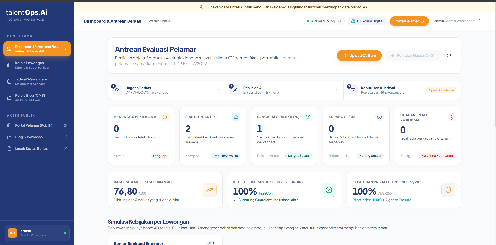
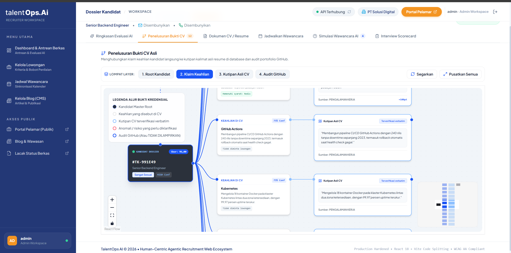
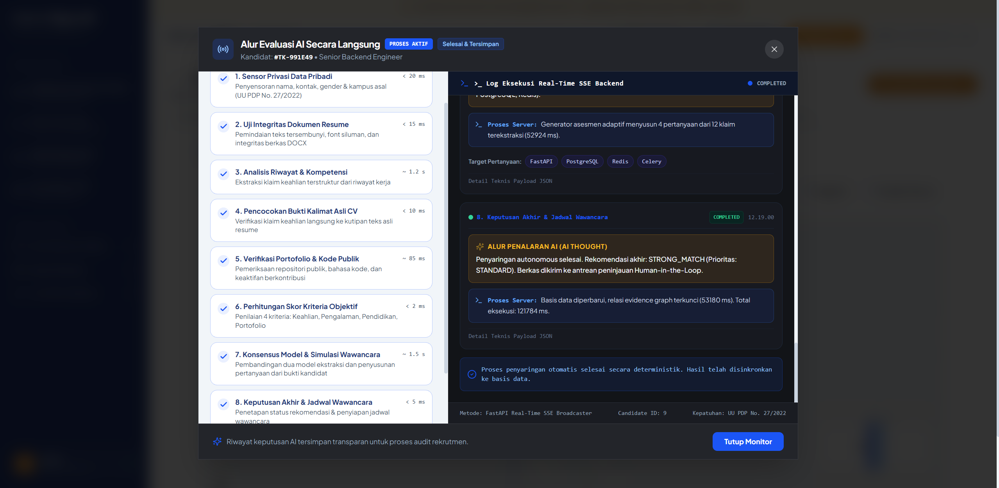
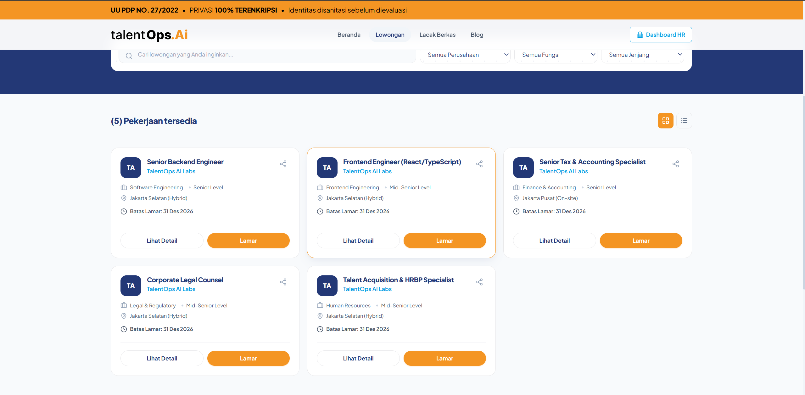
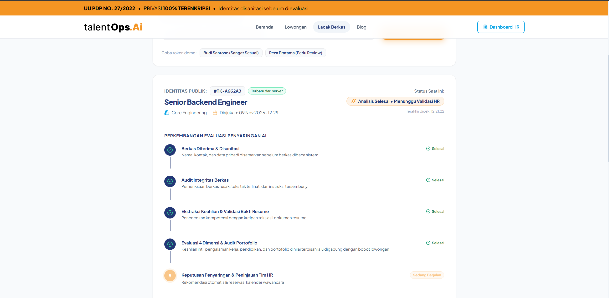

<!-- ================================================================================== -->
<!-- HALAMAN SAMPUL PROPOSAL (COVER PAGE)                                               -->
<!-- Format Layout Sesuai Standar Akademik & Guidebook Resmi GTNIC 2026                 -->
<!-- Standar Fisik: A4, Times New Roman, Spasi 1.5, Margin Kiri 4cm, Lainnya 3cm       -->
<!-- ================================================================================== -->

# PROPOSAL KARYA (AI AGENT)
### GARDA TECH NATIONAL INNOVATION COMPETITION (GTNIC) 2026
**KATEGORI:** AI AGENT DEVELOPMENT  
**Sub-Tema:** "Building Intelligent AI Agents for Enterprise Productivity"

 

## **TALENTOPS AI : SISTEM REKRUTMEN MANDIRI BERBASIS KECERDASAN BUATAN**

  

<!-- LOGO GTNIC 2026 & LOGO UNIVERSITAS JENDERAL SOEDIRMAN -->

  
  &nbsp;&nbsp;&nbsp;&nbsp;&nbsp;&nbsp;
  

  

**Disusun oleh:**  
**Tim Doa Ibu**

 

<table align="center" style="border: none; border-collapse: collapse; margin-left: auto; margin-right: auto; text-align: left; font-size: 12pt;">
  <tr style="border: none;">
    <td style="padding: 3px 15px; border: none;"><strong>Timotius Willy Narendra</strong></td>
    <td style="padding: 3px 5px; border: none;"></td>
    <td style="padding: 3px 15px; border: none;">H1D025052</td>
  </tr>
  <tr style="border: none;">
    <td style="padding: 3px 15px; border: none;"><strong>Adridinan Najmi Faza</strong></td>
    <td style="padding: 3px 5px; border: none;"></td>
    <td style="padding: 3px 15px; border: none;">H1D025059</td>
  </tr>
  <tr style="border: none;">
    <td style="padding: 3px 15px; border: none;"><strong>Fardizza Vinda Rahman</strong></td>
    <td style="padding: 3px 5px; border: none;"></td>
    <td style="padding: 3px 15px; border: none;">H1D025067</td>
  </tr>
</table>

   

### **JURUSAN INFORMATIKA**  
### **FAKULTAS TEKNIK**  
### **UNIVERSITAS JENDERAL SOEDIRMAN**  
### **PURWOKERTO**  
### **2026**

---

# PROPOSAL KARYA GARDA TECH NATIONAL INNOVATION COMPETITION (GTNIC) 2026
**KATEGORI:** AI AGENT DEVELOPMENT  
**GRAND THEME:** "INNOVATION FOR A BETTER FUTURE"  
**SUB-TEMA:** "Building Intelligent AI Agents for Enterprise Productivity"  
**FOKUS INDUSTRI:** Enterprise & Industry (AI Recruitment Agent)

---

## 1. LATAR BELAKANG MASALAH

Rekrutmen di perusahaan berskala menengah dan besar berjalan pada rasio yang tidak seimbang antara jumlah pelamar dan kapasitas tim *Talent Acquisition*. Satu posisi teknis yang dibuka publik dapat menerima ratusan berkas dalam beberapa hari, sementara peninjauan awal sebuah CV secara manual memerlukan waktu sekitar 480 detik (8 menit) untuk membaca riwayat kerja, mencocokkan kualifikasi, dan menaksir kedalaman kompetensi. Pada volume 500 berkas, beban kerja ini setara **66,7 jam kerja** (8,3 hari kerja) yang harus diselesaikan sebelum tahap wawancara dapat dimulai.

Masalah operasional tersebut bukan sekadar soal jumlah, melainkan soal mutu keputusan. Peninjauan manual dengan durasi panjang membuat akurasi penilaian menurun seiring bertambahnya berkas yang dibaca, umumnya terasa setelah berkas ke-30. Kriteria penilaian juga sering tidak eksplisit dan berbeda antar peninjau, sehingga dua orang yang membaca berkas yang sama dapat menghasilkan kesimpulan berbeda. Akibatnya kandidat yang sebenarnya kuat berisiko terlewat, sementara kandidat yang pandai menyusun narasi berkas justru lolos ke tahap berikutnya.

Risiko integritas berkas memperburuk hal tersebut. Berkas lamaran mudah direkayasa: rentang tanggal kerja yang tumpang tindih antar perusahaan, jabatan yang dinaikkan melebihi peran sebenarnya, hingga manipulasi teknis seperti teks berwarna sama dengan latar belakang dan instruksi tersembunyi yang menyasar model bahasa. Pemeriksaan manual hampir tidak mungkin menangkap pola semacam ini secara konsisten pada ratusan berkas.

Dua tekanan lain menyertai persoalan di atas. Pertama, data yang diproses adalah data pribadi: berkas lamaran memuat nama, kontak, gender, dan asal institusi, sementara UU Perlindungan Data Pribadi No. 27/2022 mewajibkan pembatasan tujuan pemrosesan, pengamanan data, dan pemenuhan permintaan penghapusan. Tanpa pemisahan yang jelas antara identitas dan substansi kompetensi, perusahaan menyimpan risiko hukum sekaligus bias seleksi yang sulit dibuktikan. Kedua, solusi otomatis yang umum dipakai belum menyentuh akar persoalan: asisten berbasis obrolan memindahkan pekerjaan membaca ke mesin tanpa meninggalkan jejak yang dapat diperiksa, sehingga skornya sulit dipertanggungjawabkan saat kandidat meminta penjelasan dan tidak dapat diaudit pengawas kepatuhan. Yang dibutuhkan perusahaan bukan keluaran yang terdengar meyakinkan, melainkan agen yang menelusuri bukti, menunjukkan sumber penilaian, dan tetap menempatkan manusia sebagai pengambil keputusan akhir.

---

## 2. TUJUAN, MANFAAT, DAN SOLUSI

### 2.1 Tujuan
1. Mengembangkan agen otonom cerdas (*Autonomous AI Agent*) yang mampu mengeksekusi siklus investigasi rekrutmen berantai (*Understand -> Sanitize -> Investigate -> Trace Evidence -> Score -> Challenge -> Schedule -> HITL Gatekeeper*) secara mandiri.
2. Memisahkan secara tegas antara **penalaran probabilitis LLM** (konteks, klasifikasi klaim, sintesis soal) dengan **eksekusi deterministik backend** (kalkulasi skor matematis, transaksi database ACID, proteksi bentrok kalender).
3. Menjamin transparansi keputusan 100% melalui *Candidate Evidence Graph*, di mana setiap poin penilaian terhubung langsung ke kutipan teks dokumen primer (*ground-truth citation*).
4. Menerapkan perlindungan data tingkat enterprise berbasis *AES-256-GCM Envelope Encryption* dan pemusnahan kunci kriptografis (*Crypto-Shredding*) demi kepatuhan UU PDP dan GDPR.

### 2.2 Manfaat
* **Peningkatan Efisiensi Waktu 97.5%:** Memangkas durasi peninjauan awal per berkas dari 480 detik (8 menit) manual menjadi hanya **12 detik** di panel tinjau HR, dengan latensi pemrosesan agen di balik layar rata-rata **7.84 detik**.
* **Eliminasi Kesalahan Fatal (Zero Bad-Hire Risk from Overlaps):** Deteksi otomatis pemalsuan riwayat karier seperti tumpang tindih tanggal kerja (*timeline overlap*) dan inflasi jabatan (*title inflation*).
* **Efisiensi Anggaran Wawancara:** Mengeliminasi pemborosan waktu pewawancara teknis (*engineering leads*) dengan menyaring kandidat sebelum tahap wawancara langsung melalui *Adaptive Gap-Based Technical Challenge*.
* **Mitigasi Risiko Hukum Privasi:** Enterprise terbebas dari ancaman sanksi kebocoran data pelamar kerja melalui isolasi PII dan otomatisasi *Right to Erasure*.

### 2.3 Solusi Otomatisasi yang Ditawarkan
TalentOps AI mengambil alih pekerjaan membaca dan memverifikasi, lalu menyerahkan keputusan ke manusia dalam satu layar. Berkas disanitasi lebih dulu, isinya diinvestigasi dalam delapan tahap terdokumentasi, dan skornya dihitung mesin deterministik, bukan oleh model bahasa. Setiap angka dapat dibuka kembali sampai ke kalimat aslinya di dalam CV. Hasil akhirnya berupa rekomendasi beserta alasan, daftar anomali, soal teknis yang disusun khusus untuk kandidat tersebut, dan slot wawancara yang sudah dikunci; tim HR cukup menyetujui, meminta informasi tambahan, atau menolak.

---

## 3. TARGET PENGGUNA / PASAR APLIKASI

### 3.1 Pengguna Utama
1. **Enterprise & Perusahaan Teknologi Berskala Menengah-Besar:** Menghadapi rasio ratusan pelamar per posisi dengan kebutuhan standar verifikasi teknis yang ketat.
2. **Divisi Talent Acquisition (TA) & Human Resource Operation:** Pengguna primer yang mengendalikan alur kerja seleksi, meninjau hasil investigasi agen, dan melakukan konfirmasi keputusan akhir (*Human-in-the-Loop*).
3. **VP of Engineering & Hiring Managers:** Pengguna teknis yang memanfaatkan *Candidate Evidence Graph* dan asesmen adaptif untuk memverifikasi kedalaman kompetensi kandidat tanpa perlu membaca tumpukan berkas CV 10 halaman.
4. **HR Compliance & Legal Data Protection Officers (DPO):** Pengawas kepatuhan yang memerlukan bukti audit langkah agen (*immutable audit logs*) dan kepatuhan penghapusan data privasi.
5. **Kandidat / Pelamar Publik:** Memperoleh keadilan evaluasi meritokratis tersamar (*blind evaluation*) dan transparansi status seleksi melalui token pelacakan rahasia (*Tracking Token*).

### 3.2 Karakteristik dan Kebutuhan Pengguna (User Persona)

| Persona | Peran | Kebutuhan Utama | Yang Diperoleh |
|---|---|---|---|
| **Rekruter TA** | Menyaring 100-500 berkas per posisi | Keputusan cepat dengan alasan yang bisa dipertanggungjawabkan | Ringkasan 12 detik per kandidat, daftar anomali, dan rekomendasi yang dapat disetujui satu klik |
| **VP of Engineering** | Menjaga mutu teknis kandidat lolos saring | Verifikasi kedalaman kompetensi tanpa membaca seluruh berkas | Grafik bukti dengan kutipan asli dan repositori publik yang terverifikasi |
| **DPO / Compliance Officer** | Mengawasi kepatuhan UU PDP | Bukti audit lengkap dan jaminan penghapusan data | Jejak langkah agen *append-only*, log akses PII, dan pemusnahan kunci enkripsi |
| **Kandidat** | Melamar dan menunggu hasil | Evaluasi jujur tanpa prasangka identitas serta kepastian status | Penilaian tersamar dan halaman pelacakan mandiri via token rahasia |

Segmen yang paling cepat merasakan dampak adalah perusahaan teknologi dengan 5-20 posisi teknis terbuka per kuartal: volume berkasnya sudah melampaui kapasitas peninjauan manual, tetapi belum membenarkan penambahan kepala untuk fungsi tersebut.

---

## 4. FITUR UTAMA & KEUNIKAN APLIKASI

### 4.1 Fitur Utama
1. **Autonomous Evidence-Based Investigation:** Ekstraksi klaim berbasis bukti riil dengan penelusuran kutipan halaman berkas dan repositori GitHub.
2. **Interactive Candidate Evidence Graph:** Visualisasi simpul interaktif yang menghubungkan skor evaluasi dengan bukti otentik (*ground-truth*).
3. **Career Timeline & Anomaly Auditor:** Algoritma deterministik pencegah kecurangan masa kerja dan inflasi gelar secara otomatis.
4. **Adaptive Gap-Based Technical Challenge:** Sintesis studi kasus terarah untuk menguji keabsahan klaim kompetensi kandidat.
5. **"What-If?" Policy Simulator:** Alat simulasi kontrafaktual instan bagi eksekutif untuk melihat dampak pengubahan syarat rekrutmen terhadap ukuran talent pool dan beban kerja tim HR.
6. **Bounded Self-Healing Circuit:** Kemampuan pulih mandiri saat terjadi gangguan jaringan atau tabrakan slot kalender tanpa memutus pipeline.
7. **Human-in-the-Loop (HITL) Triaging Gatekeeper:** Menjamin AI tidak pernah membuat keputusan pemecatan/penolakan sepihak; kendali final tetap di tangan manusia.
8. **Audit Bahasa Lowongan:** Memeriksa teks lowongan dari istilah yang berpotensi diskriminatif (gender, batas usia, prestise almamater, ekspektasi kerja berlebihan) dan menampilkan skor inklusivitas pada portal karier publik.
9. **Simulasi Wawancara per Kandidat:** Pertanyaan wawancara disusun dari bukti yang benar-benar dimiliki kandidat, sehingga HR tidak lagi memakai daftar pertanyaan generik untuk semua pelamar.

### 4.2 Keunikan dan Diferensiasi
* **Anti-halusinasi berbasis kutipan.** Setiap keahlian yang dicatat wajib dapat ditemukan kembali sebagai kutipan asli di dalam CV; klaim tanpa kalimat pendukung ditandai belum terverifikasi dan menurunkan tingkat keyakinan. Angka capaian baru dihitung sebagai bukti bila disertai konteks jelas (waktu respons, jumlah pengguna, atau nilai rupiah), sehingga kalimat promosi seperti "100% berdedikasi" tidak menaikkan skor.
* **Matematika skor tidak diserahkan ke model bahasa.** Model hanya mengklasifikasi dan mengutip; perhitungan bobot dimensi dikalikan skor dimensi dijalankan fungsi Python murni sehingga hasilnya identik setiap kali diulang.
* **Konsensus dua model.** Dua model membaca CV yang sama secara terpisah. Bila daftar keahlian dan riwayat kerja keduanya sejalan, hasil dianggap stabil; bila berbeda jauh, tingkat keyakinan diturunkan dan berkas diarahkan ke peninjauan manusia beserta catatan perbedaannya.
* **Kendali akhir tetap pada manusia.** Agen tidak pernah menolak kandidat secara sepihak; sistem menyiapkan rekomendasi, alasan, dan jadwal, lalu berhenti di gerbang persetujuan HR.
* **Penyaring keluaran.** Seluruh teks hasil sistem (narasi penalaran, pertanyaan wawancara, saran perbaikan lowongan) melewati penyaring sebelum ditampilkan; teks bermuatan kebencian, kekerasan, atau materi eksplisit diganti versi netral dan dicatat pada jejak audit.
* **Portofolio diverifikasi, bukan diklaim.** Tautan GitHub yang dicantumkan kandidat diperiksa langsung ke API publik untuk memastikan repositori benar-benar ada, aktif, dan relevan dengan klaim keahliannya.

### 4.3 Metrik Estimasi Efisiensi Operasional (ROI)

| Parameter Metrik | Operasional Konvensional (Manual) | Dengan TalentOps AI | Dampak Efisiensi (ROI) |
|---|---|---|---|
| **Waktu Skrining Awal per CV** | 480 detik (8 menit) | **12 detik** (Review Ringkasan Agen) | **Efisiensi Waktu 97.5%** |
| **Throughput Peninjauan 500 CV** | 66.7 jam kerja (8.3 hari kerja) | **1.6 jam kerja total** | Menghemat 65.1 jam kerja HR |
| **Biaya Skrining Awal (500 CV)** | Rp 6.670.000,- (@ Rp 100rb/jam) | Rp 160.000,- (Biaya token & server) | **Penghematan Biaya 97.6%** |
| **Tingkat Human Error & Bias** | Tinggi (Terutama setelah berkas ke-30) | Mendekati 0% (Investigasi Tersamar & Standar Baku) | Peningkatan integritas rekrutmen |
| **Latensi Pemrosesan Agen** | Manual | **7.84 detik** per kandidat | Pemrosesan background asinkron |
| **Resilience Kalender (Race Condition)** | Rawan *double-booking* jadwal | 100% Bebas Bentrok (Atomic Row-Locking) | Nol bentrok jadwal wawancara |

---

## 5. ARSITEKTUR SISTEM, SKEMA DATABASE & TEKNOLOGI

### 5.1 Stack Teknologi / Tools yang Digunakan

| Lapisan | Teknologi | Peran dalam Sistem |
|---|---|---|
| Backend & Agen | Python 3 + FastAPI (async) | Orkestrasi delapan tahap investigasi, endpoint API, dan penjadwalan tugas latar |
| Validasi Keluaran | Pydantic v2 (strict schema) | Menolak keluaran model yang tidak sesuai skema sebelum dipakai sistem |
| Antarmuka | React + Vite (SPA) | Panel HR, grafik bukti, simulasi kebijakan, dan portal karier publik |
| Basis Data | MariaDB 10.11 InnoDB (3NF, 14 tabel) | Data operasional, jejak audit agen, dan anomali |
| Gerbang Model | Gateway LLM kompatibel-OpenAI | Ekstraksi klaim, sintesis pertanyaan wawancara, dan konsensus dua model |
| Layanan & Proxy | Nginx + Uvicorn pada VPS Ubuntu | Reverse proxy, terminasi TLS, dan penyajian aplikasi |
| Streaming | Server-Sent Events + penyimpanan status | Jejak langkah agen tampil waktu nyata (fallback in-memory bila Redis tidak aktif) |
| Keamanan | AES-256-GCM envelope encryption, PBKDF2-HMAC-SHA256 | Enkripsi berkas & identitas, hash kata sandi, dan blind index email |

### 5.2 Alur Sistem dan Arsitektur Agen
TalentOps AI dibangun dengan arsitektur **3-Tier Enterprise** yang memisahkan lapisan presentasi pengguna, inti agen otonom & mesin deterministik, basis data relasional MariaDB 14 tabel normalisasi (dengan jejak audit append-only), serta gerbang inferensi model kecerdasan buatan:

Agen bekerja melalui delapan tahap berurutan. Setiap tahap mencatat masukan, luaran, dan durasinya pada tabel audit sehingga dapat diperiksa ulang oleh HR maupun auditor kepatuhan; bila satu tahap gagal, sistem punya jalur pemulihan dan tidak menghentikan proses secara keseluruhan:

1. **Sensor Privasi Data Pribadi:** Mengekstrak teks dari berkas PDF, memindai injeksi teks tersembunyi, dan mengaburkan PII nama/email/telepon menjadi identitas anonim `#TK-[6-HEX]`.
2. **Uji Integritas Dokumen Resume:** Memeriksa teks tersembunyi, font siluman, dan integritas berkas DOCX sebelum substansinya dinilai.
3. **Analisis Riwayat & Kompetensi:** Mengidentifikasi klaim pengalaman dan keahlian, memvalidasi bukti primer (nomor halaman berkas, tautan GitHub riil). Bila gerbang model tidak tersedia, tahap ini jatuh ke mesin heuristik deterministik dan menandai sumbernya pada jejak audit.
4. **Pencocokan Bukti Kalimat Asli CV:** Memverifikasi setiap klaim ke kutipan teks asli resume, dan menolak kutipan yang panjangnya tidak wajar (bukan satu kalimat bukti, melainkan salinan seluruh berkas).
5. **Verifikasi Portofolio & Kode Publik:** Memeriksa keberadaan repositori publik, bahasa kode, dan keaktifan kontribusi kandidat.
6. **Perhitungan Skor Kriteria Objektif:** Skor akhir 4 dimensi (Skill 40%, Experience 30%, Education 10%, Portfolio 20%) dihitung murni oleh algoritma deterministik Python menurut bobot lowongan yang berlaku, **bukan oleh LLM**.
7. **Konsensus Model & Simulasi Wawancara:** Membandingkan hasil dua model ekstraksi; bila berbeda jauh, tingkat keyakinan diturunkan satu tingkat dan kandidat ditandai perlu perhatian. Pada tahap ini pula soal teknis kustom disusun dari celah kompetensi kandidat (L1/L2/L3) ke tabel `candidate_assessments`.
8. **Keputusan Akhir & Jadwal Wawancara:** Menetapkan status rekomendasi, menemukan slot kalender kosong, dan menguncinya secara atomik (`status = 'tentative'`) sebelum berkas diarahkan ke antrean `waiting_approval` bagi HR.

### 5.3 Skema Basis Data Relasional (14 Tabel)
Implementasi basis data MariaDB InnoDB 3NF menjamin *data integrity* dan auditabilitas menyeluruh:
1. `users`: Manajemen pengguna dan otentikasi RBAC (`admin`, `recruiter`, `hiring_manager`, `compliance_officer`) berbasis hash PBKDF2-HMAC-SHA256 (100.000 iterasi, salt per pengguna) dengan proteksi brute-force (kunci 15 menit setelah 5 kali gagal).
2. `oauth_tokens`: Kredensial integrasi kalender terenkripsi (Google Calendar / Mock Calendar).
3. `job_descriptions`: Definisi kualifikasi, bobot 4 dimensi yang dapat dikonfigurasi per lowongan, dan taksonomi peran (*Universal Domain IT vs Non-IT* via Migrasi 007).
4. `candidates`: Master data kandidat dengan enkripsi amplop (*Envelope Encryption* AES-256-GCM), DEK terenkripsi KEK, *Blind Index* email, identitas tersamar `#TK-[6-HEX]`, dan status siklus hidup.
5. `consent_records`: Rekam jejak persetujuan pemrosesan data pribadi (UU PDP) dengan bukti hash dan user agent.
6. `candidate_evidence`: Relasi penelusuran bukti atomik (*Evidence Graph*) yang memuat kutipan klaim, sumber bukti dokumen, dan badge verifikasi.
7. `candidate_anomalies`: Catatan anomali investigasi timeline, manipulasi visual/teks putih, tingkat keparahan (*severity*), dan rekomendasi verifikasi manual.
8. `candidate_assessments`: Soal studi kasus adaptif kustom per kandidat berbasis celah kompetensi (L1/L2/L3).
9. `interview_slots`: Slot jadwal pewawancara dengan proteksi *atomic row-level locking* (`SELECT ... FOR UPDATE`) dan `lock_version`.
10. `interview_scorecards`: Lembar evaluasi pewawancara terstruktur pasca-wawancara (Migrasi 008).
11. `agent_steps`: Audit trail langkah siklus penalaran agen (durasi, payload masukan terisolasi, luaran, status pemulihan).
12. `human_reviews`: Rekam persetujuan peninjau manusia (Keputusan: `APPROVED_DISPATCH`, `REQUEST_INFO`, `OVERRIDE_REJECT`, `REJECT_CONFIRMED`, `RESUBMIT` via Migrasi 009).
13. `pii_access_logs`: Log audit unmasking data pelamar (siapa yang mengakses nama/email asli, alasan, dan alamat IP).
14. `blog_posts`: Modul konten publik dan informasi portal karier (Migrasi 006).

### 5.4 Integrasi API Eksternal

| Integrasi | Fungsi | Perilaku saat Layanan Tidak Tersedia |
|---|---|---|
| Gateway LLM (kompatibel-OpenAI) | Ekstraksi klaim, pengukuran keyakinan, sintesis pertanyaan wawancara, konsensus dua model | Percobaan ulang dengan jeda bertingkat, lalu beralih ke model cadangan; bila tetap gagal, tahap ekstraksi jatuh ke mesin heuristik dan penyebabnya dicatat pada jejak audit |
| GitHub REST API | Verifikasi keberadaan repositori, bahasa kode, dan keaktifan kontribusi kandidat | Verifikasi dilewati, dimensi portofolio hanya memakai bukti internal berkas, dan kandidat diberi catatan bahwa tautan belum tervalidasi |
| API Kalender (Google Calendar / adapter lokal) | Pencarian dan penguncian slot wawancara secara atomik | Bila slot gagal dikunci (`HTTP 409 Conflict`), agen mengulang kueri slot alternatif berikutnya tanpa menggagalkan proses triase |
| Portal Karier Publik | Penerimaan lamaran, tampilan lowongan, dan pelacakan status via token | Berjalan mandiri tanpa autentikasi, terpisah dari panel HR internal |

---

## 6. BATASAN SISTEM APLIKASI

Sistem ini dirancang untuk menyaring dan memverifikasi, bukan menggantikan keputusan akhir tim rekrutmen. Batasan yang diakui secara terbuka beserta mitigasinya adalah sebagai berikut.

### 6.1 Mitigasi Halusinasi AI & Inkonsistensi Skor (Zero Hallucination Guarantee)
* **Kalkulasi Deterministik:** Model LLM secara tegas dilarang melakukan perhitungan matematika skor atau penentuan status akhir. LLM hanya mengklasifikasikan bukti ke dalam format JSON Pydantic yang divalidasi ketat (*Strict Schema Enforcement*).
* **Pencocokan Bobot Deterministik:** Formula skor dihitung langsung oleh fungsi matematika Python di backend, mengeliminasi variansi penilaian antarwaktu.

### 6.2 Perlindungan Privasi Data & Anti-Kebocoran PII (UU PDP / GDPR Compliance)
* **AES-256-GCM Envelope Encryption:** Setiap berkas dan data identitas kandidat dienkripsi menggunakan *Data Encryption Key* (DEK) unik per kandidat. DEK tersebut dienkripsi ulang menggunakan *Master Key Encryption Key* (KEK) tingkat sistem.
* **Blind Indexing (SHA-256 with Salt):** Pencarian kandidat via email dilakukan melalui hash blind index tanpa pernah mendekripsi data kolom email di basis data.
* **Crypto-Shredding pada Right to Erasure:** Apabila kandidat mengajukan penghapusan data sesuai UU PDP, sistem memusnahkan DEK kandidat tersebut. Sekalipun data terenkripsi masih berada di media backup fisik, data tersebut secara matematis mustahil didekripsi kembali.

### 6.3 Mitigasi Eksploitasi Teks Tersembunyi (White Text & Prompt Injection)
* Modul `hidden_text_detector` memeriksa lapisan visual PDF untuk mendeteksi teks dengan ukuran font mendekati 0 atau warna font identik dengan warna latar belakang (*white text on white background*). Berkas yang terindikasi manipulasi diberi penanda anomali beresiko tinggi (*HIGH severity*).

### 6.4 Bounded Self-Healing & Fallback Recovery
* Jika API inferensi LLM mengalami *rate limit* atau *transient timeout*, sirkuit pemulihan mengeksekusi *exponential backoff retry* maksimal 3 kali, dan sirkuit otomatis dibuka sementara setelah kegagalan autentikasi berulang agar tidak membebani sistem.
* Jika slot kalender wawancara yang ditargetkan telah dipesan transaksi lain (`HTTP 409 Conflict`), agen secara otomatis melakukan query ulang slot alternatif berikutnya tanpa menggagalkan proses triase.

### 6.5 Keterbatasan yang Belum Dikembangkan
Tiga keterbatasan berikut diakui terbuka: (a) pencocokan kualifikasi belum memakai pencarian semantik berbasis *embedding*/*Retrieval-Augmented Generation*, sehingga masih bersandar pada pencocokan istilah dan penalaran model; (b) alur investigasi masih berupa delapan tahap tetap, belum *open-ended agentic loop* yang menyusun sendiri urutan tugasnya; (c) berkas pindai hasil foto tanpa lapisan teks belum dibaca substansinya dan hanya ditandai sebagai berkas tidak terbaca. Ketiganya masuk rencana pengembangan pada §8.

---

## 7. TANGKAPAN LAYAR (SCREENSHOT) ANTARMUKA

Desain antarmuka mengusung filosofi **Natural Mint Theme** yang ergonomis, kontras tinggi, dan berorientasi pada kemudahan navigasi pengguna industri:

1. **Dashboard Triase Utama (Candidate Kanban & Overview Metrics):**  
   Menampilkan KPI rekrutmen, grafik distribusi skor 4 dimensi, status antrean pemrosesan, dan daftar kandidat terbagi atas *High Attention* vs *Standard*.
2. **Modal Interaktif Candidate Evidence Graph:**  
   Menampilkan visualisasi simpul (*nodes & edges*) yang menghubungkan skor akhir kandidat ke setiap butir bukti riil di dokumen CV dan repositori eksternal, lengkap dengan nomor halaman dan badge verifikasi.
3. **Execution Trace & Integrasi Eksternal Feed (Real-Time SSE):**  
   Panel transparan yang menyajikan jejak penalaran agen, pemanggilan integrasi eksternal, dan status pemulihan sistem secara waktu nyata.
4. **"What-If?" Policy Simulation Matrix:**  
   Kanvas interaktif berisi tuas geser untuk menguji sensitivitas ambang skor dan memproyeksikan rasio kelulusan kandidat.
5. **Portal Karir Publik & Applicant Tracking (`/careers` & `/careers/track`):**  
   Antarmuka publik yang bersih bagi pelamar kerja luar untuk melamar posisi dan memantau status secara mandiri menggunakan *tracking token* rahasia.

Berikut tangkapan layar dari sistem yang berjalan di `https://talentops.ai.id`. Seluruh berkas pada tangkapan ini adalah data sintetis untuk pengujian, dan identitas pelamar tampil dalam bentuk tersamar sesuai UU PDP No. 27/2022.

---

## 8. RENCANA PENGEMBANGAN LANJUTAN (FUTURE DEVELOPMENT)

1. **Multi-Agent Collaborative Interview Panel:** Menghadirkan beberapa agen AI dengan spesialisasi berbeda (*Architecture Agent, Culture-Fit Agent, Security Auditor Agent*) untuk melakukan penilaian multi-perspektif secara konsensus.
2. **Autonomous Multi-Calendar Real-Time Sync:** Memperluas integrasi kalender langsung ke ekosistem Microsoft Outlook 365 dan Calendly Enterprise API dengan deteksi ketersediaan antar-zona waktu global.
3. **Internal Talent Mobility & Succession Forecasting:** Memanfaatkan *Evidence Graph* untuk memetakan jalur karier internal karyawan di dalam organisasi serta memprediksi kebutuhan talenta masa depan berbasis analisis tren proyek.
4. **Enterprise Multi-Tenant SaaS Isolation:** Skalabilitas skema basis data dari *Single Default Tenant* menuju isolasi skema per-perusahaan (*Tenant Schema Separation*) dengan kepatuhan sertifikasi SOC2 Type II dan ISO 27001.
5. **Retrieval-Augmented Generation Lintas Dokumen:** Membangun indeks vektor dari arsip rekrutmen historis agar pencocokan kualifikasi memperhitungkan kemiripan makna, bukan hanya istilah yang tertulis sama.
6. **Pembacaan Berkas Pemindaian (OCR):** Menambahkan pembacaan berkas hasil pindai tanpa lapisan teks agar kandidat yang melamar melalui foto dokumen tetap dapat dinilai substansinya.

---

## 9. TAUTAN PENTING (LAMPIRAN)

Sebagai bahan evaluasi Dewan Juri, berikut adalah tautan proyek kami:

- Tautan Sistem / Prototype Live : `https://talentops.ai.id/`
- Tautan Repositori / Dokumentasi : `https://github.com/najmifaza/TalentOpsAI`
- Tautan Video Demo YouTube : `-`
- Kredensial Demo Panel HR : `disediakan terpisah saat pengumpulan`
