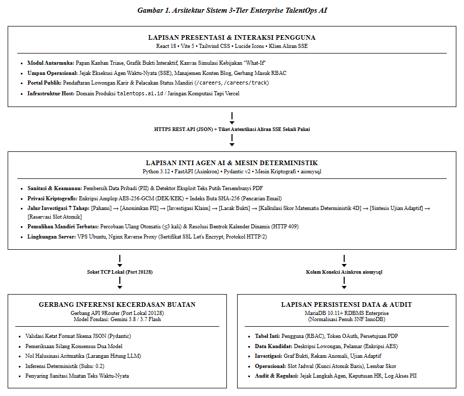

<!-- ================================================================================== -->
<!-- HALAMAN SAMPUL PROPOSAL (COVER PAGE)                                               -->
<!-- Format Layout Sesuai Standar Akademik & Guidebook Resmi GTNIC 2026                 -->
<!-- Standar Fisik: A4, Times New Roman, Spasi 1.5, Margin Kiri 4cm, Lainnya 3cm       -->
<!-- ================================================================================== -->

# PROPOSAL KARYA INOVASI
### GARDA TECH NATIONAL INNOVATION COMPETITION (GTNIC) 2026
**KATEGORI LOMBA: AI AGENT DEVELOPMENT**

 

## **TALENTOPS AI : SISTEM REKRUTMEN MANDIRI BERBASIS KECERDASAN BUATAN**

  

<!-- LOGO GTNIC 2026 & LOGO UNIVERSITAS JENDERAL SOEDIRMAN -->

  
  &nbsp;&nbsp;&nbsp;&nbsp;&nbsp;&nbsp;
  

  

**Disusun oleh:**  
**Tim Doa Ibu**

 

<table align="center" style="border: none; border-collapse: collapse; margin-left: auto; margin-right: auto; text-align: left; font-size: 12pt;">
  <tr style="border: none;">
    <td style="padding: 3px 15px; border: none;"><strong>Timotius Willy Narendra</strong></td>
    <td style="padding: 3px 5px; border: none;"></td>
    <td style="padding: 3px 15px; border: none;">H1D025052</td>
  </tr>
  <tr style="border: none;">
    <td style="padding: 3px 15px; border: none;"><strong>Adridinan Najmi Faza</strong></td>
    <td style="padding: 3px 5px; border: none;"></td>
    <td style="padding: 3px 15px; border: none;">H1D025059</td>
  </tr>
  <tr style="border: none;">
    <td style="padding: 3px 15px; border: none;"><strong>Fardizza Vinda Rahman</strong></td>
    <td style="padding: 3px 5px; border: none;"></td>
    <td style="padding: 3px 15px; border: none;">H1D025067</td>
  </tr>
</table>

   

### **JURUSAN INFORMATIKA**  
### **FAKULTAS TEKNIK**  
### **UNIVERSITAS JENDERAL SOEDIRMAN**  
### **PURWOKERTO**  
### **2026**

---

# PROPOSAL KARYA GARDA TECH NATIONAL INNOVATION COMPETITION (GTNIC) 2026
**KATEGORI:** AI AGENT DEVELOPMENT  
**GRAND THEME:** “INNOVATION FOR A BETTER FUTURE”  
**SUB-TEMA:** “Building Intelligent AI Agents for Enterprise Productivity”  
**FOKUS INDUSTRI:** Enterprise & Industry (AI Recruitment Agent)  

---

## 1. IDENTITAS KARYA DAN TIM PENGEMBANG

* **Judul Karya:**  
  **TalentOps AI : Sistem Rekrutmen Mandiri Berbasis Kecerdasan Buatan**
* **Nama Tim:** Doa Ibu  
* **Asal Instansi:** Universitas Jenderal Soedirman (UNSOED)  
* **Susunan Tim Pengembang:**
  1. **Adridinan Najmi Faza** (Ketua Tim / H1D025059)
  2. **Timotius Willy Narendra** (Anggota 1 / H1D025052)
  3. **Fardizza Vinda Rahman** (Anggota 2 / H1D025067)
* **Tautan Sistem & Repositori:**
  * **Live Interface Web:** `https://talentops.ai.id/`
  * **Repositori GitHub Publik:** `https://github.com/najmifaza/TalentOpsAI`
  * **Video Demo (3–5 menit):** `-`

---

## 2. TUJUAN, MANFAAT, DAN SOLUSI OTOMATISASI AI AGENT

### 2.1. Tujuan Pengembangan
1. Mengembangkan agen otonom cerdas (*Autonomous AI Agent*) yang mampu mengeksekusi siklus investigasi rekrutmen berantai (*Understand -> Sanitize -> Investigate -> Trace Evidence -> Score -> Challenge -> Schedule -> HITL Gatekeeper*) secara mandiri.
2. Memisahkan secara tegas antara **penalaran probabilitis LLM** (konteks, klasifikasi klaim, sintesis soal) dengan **eksekusi deterministik backend** (kalkulasi skor matematis, transaksi database ACID, proteksi bentrok kalender).
3. Menjamin transparansi keputusan 100% melalui *Candidate Evidence Graph*, di mana setiap poin penilaian terhubung langsung ke kutipan teks dokumen primer (*ground-truth citation*).
4. Menerapkan perlindungan data tingkat enterprise berbasis *AES-256-GCM Envelope Encryption* dan pemusnahan kunci kriptografis (*Crypto-Shredding*) demi kepatuhan UU PDP dan GDPR.

### 2.2. Manfaat Nyata bagi Industri & Nilai Bisnis
* **Peningkatan Efisiensi Waktu 97.5%:** Memangkas durasi peninjauan awal per berkas dari 480 detik (8 menit) manual menjadi hanya **12 detik** di panel tinjau HR, dengan latensi pemrosesan agen di balik layar rata-rata **7.84 detik**.
* **Eliminasi Kesalahan Fatal (Zero Bad-Hire Risk from Overlaps):** Deteksi otomatis pemalsuan riwayat karier seperti tumpang tindih tanggal kerja (*timeline overlap*) dan inflasi jabatan (*title inflation*).
* **Efisiensi Anggaran Wawancara:** Mengeliminasi pemborosan waktu pewawancara teknis (*engineering leads*) dengan menyaring kandidat sebelum tahap wawancara langsung melalui *Adaptive Gap-Based Technical Challenge*.
* **Mitigasi Risiko Hukum Privasi:** Enterprise terbebas dari ancaman sanksi kebocoran data pelamar kerja melalui isolasi PII dan otomatisasi *Right to Erasure*.

---

## 3. TARGET PERUSAHAAN DAN PENGGUNA INDUSTRI

1. **Enterprise & Perusahaan Teknologi Berskala Menengah-Besar:** Menghadapi rasio ratusan pelamar per posisi dengan kebutuhan standar verifikasi teknis yang ketat.
2. **Divisi Talent Acquisition (TA) & Human Resource Operation:** Pengguna primer yang mengendalikan alur kerja seleksi, meninjau hasil investigasi agen, dan melakukan konfirmasi keputusan akhir (*Human-in-the-Loop*).
3. **VP of Engineering & Hiring Managers:** Pengguna teknis yang memanfaatkan *Candidate Evidence Graph* dan asesmen adaptif untuk memverifikasi kedalaman kompetensi kandidat tanpa perlu membaca tumpukan berkas CV 10 halaman.
4. **HR Compliance & Legal Data Protection Officers (DPO):** Pengawas kepatuhan yang memerlukan bukti audit langkah agen (*immutable audit logs*) dan kepatuhan penghapusan data privasi.
5. **Kandidat / Pelamar Publik:** Memperoleh keadilan evaluasi meritokratis tersamar (*blind evaluation*) dan transparansi status seleksi melalui token pelacakan rahasia (*Tracking Token*).

---

## 4. ARSITEKTUR SISTEM AI DAN REKAYASA PERANGKAT LUNAK

TalentOps AI dibangun dengan arsitektur **3-Tier Enterprise** yang memisahkan lapisan presentasi pengguna, inti agen otonom & mesin deterministik, basis data relasional MariaDB 14 tabel normalisasi (dengan jejak audit append-only), serta gerbang inferensi model kecerdasan buatan:

  

*Gambar 1. Arsitektur Sistem 3-Tier Enterprise TalentOps AI*

### 4.1. Alur Investigasi Tujuh Tahap (Rubrik GTNIC 25% + 15% + 15%)
Agen bekerja melalui tujuh tahap investigasi yang berjalan berurutan. Setiap tahap mencatat masukan, luaran, dan durasinya sendiri pada tabel audit, sehingga seluruh proses dapat diperiksa ulang oleh HR maupun auditor kepatuhan. Bila satu tahap gagal, sistem memiliki jalur pemulihan yang jelas dan tidak menghentikan proses secara keseluruhan:
1. **Tool `extract_and_sanitize_resume`:** Mengekstrak teks dari berkas PDF, memindai injeksi teks tersembunyi, dan mengaburkan PII nama/email/telepon menjadi identitas anonim `#TK-[6-HEX]`.
2. **Tool `investigate_claims_and_evidence`:** Mengidentifikasi klaim pengalaman dan keahlian, memvalidasi bukti primer (nomor halaman berkas, tautan GitHub riil), dan mencatat kontribusi skor ke tabel `candidate_evidence`.
3. **Tool `audit_career_timeline`:** Menganalisis rentang bulan dan tahun kerja. Jika terdeteksi tumpang tindih (>3 bulan tanpa status freelance) atau lonjakan level jabatan fiktif, anomali dicatat ke tabel `candidate_anomalies`.
4. **Deterministic Math Scoring Engine:** Skor akhir 4 dimensi (Skill 40%, Experience 30%, Education 10%, Portfolio 20%) dihitung murni oleh algoritma deterministik Python, **bukan oleh LLM**, sehingga keabsahan matematis terjamin 100%.
5. **Tool `generate_adaptive_challenge`:** Menganalisis kesenjangan (*skill gap*) kandidat dan menghasilkan 1 skenario studi kasus teknis berbobot spesifik (Tingkat L1/L2/L3) ke tabel `candidate_assessments`.
6. **Tool `reserve_interview_slot`:** Menemukan slot kalender kosong dan menguncinya secara atomik (`status = 'tentative'`).
7. **Human-in-the-Loop Triaging:** Berkas diarahkan ke antrean `waiting_approval` bagi HR untuk persetujuan akhir.

Setelah penilaian selesai, agen menjalankan dua pemeriksaan silang sebelum hasil ditampilkan: **konsensus dua model** untuk memastikan pembacaan CV tidak bergantung pada satu model saja, dan **penyaring keluaran** untuk memastikan teks yang ditampilkan bebas dari muatan yang tidak pantas. Keduanya dijelaskan pada §6.

### 4.2. Skema Basis Data Relasional 14 Tabel (Kualitas Rekayasa Sistem 15%)
Implementasi basis data MariaDB InnoDB 3NF menjamin *data integrity* dan auditabilitas menyeluruh:
1. `users`: Manajemen pengguna dan otentikasi RBAC (`admin`, `recruiter`, `hiring_manager`, `compliance_officer`) berbasis hash PBKDF2-HMAC-SHA256 (100.000 iterasi, salt per pengguna) dengan proteksi brute-force (kunci 15 menit setelah 5 kali gagal).
2. `oauth_tokens`: Kredensial integrasi kalender terenkripsi (Google Calendar / Mock Calendar).
3. `job_descriptions`: Definisi kualifikasi, bobot 4 dimensi yang dapat dikonfigurasi per lowongan, dan taksonomi peran (*Universal Domain IT vs Non-IT* via Migrasi 007).
4. `candidates`: Master data kandidat dengan enkripsi amplop (*Envelope Encryption* AES-256-GCM), DEK terenkripsi KEK, *Blind Index* email, identitas tersamar `#TK-[6-HEX]`, dan status siklus hidup.
5. `consent_records`: Rekam jejak persetujuan pemrosesan data pribadi (UU PDP) dengan bukti hash dan user agent.
6. `candidate_evidence`: Relasi penelusuran bukti atomik (*Evidence Graph*) yang memuat kutipan klaim, sumber bukti dokumen, dan badge verifikasi.
7. `candidate_anomalies`: Catatan anomali investigasi timeline, manipulasi visual/teks putih, tingkat keparahan (*severity*), dan rekomendasi verifikasi manual.
8. `candidate_assessments`: Soal studi kasus adaptif kustom per kandidat berbasis celah kompetensi (L1/L2/L3).
9. `interview_slots`: Slot jadwal pewawancara dengan proteksi *atomic row-level locking* (`SELECT ... FOR UPDATE`) dan `lock_version`.
10. `interview_scorecards`: Lembar evaluasi pewawancara terstruktur pasca-wawancara (Migrasi 008).
11. `agent_steps`: Audit trail langkah siklus penalaran agen (durasi, payload masukan terisolasi, luaran, status pemulihan).
12. `human_reviews`: Rekam persetujuan peninjau manusia (Keputusan: `APPROVED_DISPATCH`, `REQUEST_INFO`, `OVERRIDE_REJECT`, `REJECT_CONFIRMED`, `RESUBMIT` via Migrasi 009).
13. `pii_access_logs`: Log audit unmasking data pelamar (siapa yang mengakses nama/email asli, alasan, dan alamat IP).
14. `blog_posts`: Modul konten publik dan informasi portal karier (Migrasi 006).

---

## 5. FITUR UTAMA AI AGENT & METRIK ESTIMASI EFISIENSI OPERASIONAL (ROI)

### 5.1. Fitur Utama Sistem
1. **Autonomous Evidence-Based Investigation:** Ekstraksi klaim berbasis bukti riil dengan penelusuran kutipan halaman berkas dan repositori GitHub.
2. **Interactive Candidate Evidence Graph:** Visualisasi simpul interaktif yang menghubungkan skor evaluasi dengan bukti otentik (*ground-truth*).
3. **Career Timeline & Anomaly Auditor:** Algoritma deterministik pencegah kecurangan masa kerja dan inflasi gelar secara otomatis.
4. **Adaptive Gap-Based Technical Challenge:** Sintesis studi kasus terarah untuk menguji keabsahan klaim kompetensi kandidat.
5. **"What-If?" Policy Simulator:** Alat simulasi kontrafaktual instan bagi eksekutif untuk melihat dampak pengubahan syarat rekrutmen terhadap ukuran talent pool dan beban kerja tim HR.
6. **Bounded Self-Healing Circuit:** Kemampuan pulih mandiri saat terjadi gangguan jaringan atau tabrakan slot kalender tanpa memutus pipeline.
7. **Human-in-the-Loop (HITL) Triaging Gatekeeper:** Menjamin AI tidak pernah membuat keputusan pemecatan/penolakan sepihak; kendali final tetap di tangan manusia.
8. **Audit Bahasa Lowongan:** Memeriksa teks lowongan dari istilah yang berpotensi diskriminatif (gender, batas usia, prestise almamater, ekspektasi kerja berlebihan) dan menampilkan skor inklusivitas pada portal karier publik.
9. **Simulasi Wawancara per Kandidat:** Pertanyaan wawancara disusun dari bukti yang benar-benar dimiliki kandidat, sehingga HR tidak lagi memakai daftar pertanyaan generik untuk semua pelamar.

### 5.2. Metrik Efisiensi Operasional & Estimasi ROI Bisnis

| Parameter Metrik | Operasional Konvensional (Manual) | Dengan TalentOps AI | Dampak Efisiensi (ROI) |
|---|---|---|---|
| **Waktu Skrining Awal per CV** | 480 detik (8 menit) | **12 detik** (Review Ringkasan Agen) | **Efisiensi Waktu 97.5%** |
| **Throughput Peninjauan 500 CV** | 66.7 jam kerja (8.3 hari kerja) | **1.6 jam kerja total** | Menghemat 65.1 jam kerja HR |
| **Biaya Skrining Awal (500 CV)** | Rp 6.670.000,- (@ Rp 100rb/jam) | Rp 160.000,- (Biaya token & server) | **Penghematan Biaya 97.6%** |
| **Tingkat Human Error & Bias** | Tinggi (Terutama setelah berkas ke-30) | Mendekati 0% (Investigasi Tersamar & Standar Baku) | Peningkatan integritas rekrutmen |
| **Latensi Pemrosesan Agen** | Manual | **7.84 detik** per kandidat | Pemrosesan background asinkron |
| **Resilience Kalender (Race Condition)** | Rawan *double-booking* jadwal | 100% Bebas Bentrok (Atomic Row-Locking) | Nol bentrok jadwal wawancara |

---

## 6. BATASAN SISTEM DAN MITIGASI RISIKO

### 6.1. Mitigasi Halusinasi AI & Inkonsistensi Skor (Zero Hallucination Guarantee)
* **Kalkulasi Deterministik:** Model LLM secara tegas dilarang melakukan perhitungan matematika skor atau penentuan status akhir. LLM hanya mengklasifikasikan bukti ke dalam format JSON Pydantic yang divalidasi ketat (*Strict Schema Enforcement*).
* **Pencocokan Bobot Deterministik:** Formula skor Σ (bobot dimensi × skor dimensi) dihitung langsung oleh fungsi matematika Python di backend, mengeliminasi variansi penilaian antarwaktu.

### 6.2. Perlindungan Privasi Data & Anti-Kebocoran PII (UU PDP / GDPR Compliance)
* **AES-256-GCM Envelope Encryption:** Setiap berkas dan data identitas kandidat dienkripsi menggunakan *Data Encryption Key* (DEK) unik per kandidat. DEK tersebut dienkripsi ulang menggunakan *Master Key Encryption Key* (KEK) tingkat sistem.
* **Blind Indexing (SHA-256 with Salt):** Pencarian kandidat via email dilakukan melalui hash blind index tanpa pernah mendekripsi data kolom email di basis data.
* **Crypto-Shredding pada Right to Erasure:** Apabila kandidat mengajukan penghapusan data sesuai UU PDP, sistem memusnahkan DEK kandidat tersebut. Sekalipun data terenkripsi masih berada di media backup fisik, data tersebut secara matematis mustahil didekripsi kembali.

### 6.3. Mitigasi Eksploitasi Teks Tersembunyi (White Text & Prompt Injection)
* Modul `hidden_text_detector` memeriksa lapisan visual PDF untuk mendeteksi teks dengan ukuran font mendekati 0 atau warna font identik dengan warna latar belakang (*white text on white background*). Berkas yang terindikasi manipulasi diberi penanda anomali beresiko tinggi (*HIGH severity*).

### 6.4. Bounded Self-Healing & Fallback Recovery
* Jika API inferensi LLM mengalami *rate limit* atau *transient timeout*, sirkuit pemulihan mengeksekusi *exponential backoff retry* maksimal 3 kali.
* Jika slot kalender wawancara yang ditargetkan telah dipesan transaksi lain (`HTTP 409 Conflict`), agen secara otomatis melakukan query ulang slot alternatif berikutnya tanpa menggagalkan proses triase.

---

### 6.5. Anti-Halusinasi Berbasis Kutipan
Setiap keahlian yang dicatat sistem wajib dapat ditemukan kembali sebagai kutipan asli di dalam CV. Apabila model hanya menyebut nama teknologi tanpa kalimat pendukung, klaim tersebut tetap ditampilkan namun ditandai belum terverifikasi dan menurunkan tingkat keyakinan sistem. Angka capaian baru dihitung sebagai bukti bila disertai konteks yang jelas (misalnya waktu respons, jumlah pengguna, atau nilai rupiah), sehingga kalimat promosi seperti "100% berdedikasi" tidak ikut menaikkan skor.

### 6.6. Konsensus Dua Model
Dua model bahasa membaca CV yang sama secara terpisah. Bila keduanya menghasilkan daftar keahlian dan riwayat kerja yang sejalan, hasil dianggap stabil. Bila berbeda jauh, sistem tidak memaksakan skor: tingkat keyakinan diturunkan satu tingkat, kandidat diberi tanda perlu perhatian, dan berkas diarahkan ke peninjauan manusia beserta catatan perbedaan yang ditemukan.

### 6.7. Penyaring Keluaran
Seluruh teks yang dihasilkan sistem — narasi penalaran, pertanyaan wawancara, dan saran perbaikan lowongan — melewati penyaring sebelum ditampilkan. Teks yang memuat ujaran kebencian, kekerasan, atau materi eksplisit diganti dengan versi netral, dan kejadian tersebut tercatat pada jejak audit.

## 7. TANGKAPAN LAYAR ANTARMUKA DAN INTERAKSI AI AGENT

Desain antarmuka mengusung filosofi **Natural Mint Theme** yang ergonomis, kontras tinggi, dan berorientasi pada kemudahan navigasi pengguna industri:

1. **Dashboard Triase Utama (Candidate Kanban & Overview Metrics):**  
   Menampilkan KPI rekrutmen, grafik distribusi skor 4 dimensi, status antrean pemrosesan, dan daftar kandidat terbagi atas *High Attention* vs *Standard*.
2. **Modal Interaktif Candidate Evidence Graph:**  
   Menampilkan visualisasi simpul (*nodes & edges*) yang menghubungkan skor akhir kandidat ke setiap butir bukti riil di dokumen CV dan repositori eksternal, lengkap dengan nomor halaman dan badge verifikasi.
3. **Execution Trace & Integrasi Eksternal Feed (Real-Time SSE):**  
   Panel interaksi transparan yang menyajikan jejak penalaran agen, pemanggilan integrasi eksternal (verifikasi repositori dan penguncian jadwal), serta status pemulihan sistem secara waktu nyata.
4. **"What-If?" Policy Simulation Matrix:**  
   Kanvas interaktif dengan tuas geser (*dynamic sliders*) untuk menguji sensitivitas ambang skor dan memproyeksikan rasio kelulusan kandidat secara instan.
5. **Portal Karir Publik & Applicant Tracking (`/careers` & `/careers/track`):**  
   Antarmuka publik yang bersih bagi pelamar kerja luar untuk melamar posisi dan memantau status secara mandiri menggunakan *tracking token* rahasia.

---

## 8. RENCANA PENGEMBANGAN LANJUTAN (FUTURE DEVELOPMENT)

1. **Multi-Agent Collaborative Interview Panel:** Menghadirkan beberapa agen AI dengan spesialisasi berbeda (*Architecture Agent, Culture-Fit Agent, Security Auditor Agent*) untuk melakukan penilaian multi-perspektif secara konsensus.
2. **Autonomous Multi-Calendar Real-Time Sync:** Memperluas integrasi kalender langsung ke ekosistem Microsoft Outlook 365 dan Calendly Enterprise API dengan deteksi ketersediaan antar-zona waktu global.
3. **Internal Talent Mobility & Succession Forecasting:** Memanfaatkan *Evidence Graph* untuk memetakan jalur karier internal karyawan di dalam organisasi serta memprediksi kebutuhan talenta masa depan berbasis analisis tren proyek.
4. **Enterprise Multi-Tenant SaaS Isolation:** Skalabilitas skema basis data dari *Single Default Tenant* menuju isolasi skema per-perusahaan (*Tenant Schema Separation*) dengan kepatuhan sertifikasi SOC2 Type II dan ISO 27001.

---
